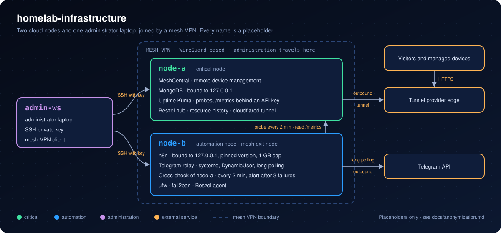

<h1 align="center">Homelab Infrastructure</h1>

<p align="center">
  <b>Public, anonymized documentation of a small two-server infrastructure: remote management, monitoring and a read-only status bot.</b><br>
  Mesh VPN administration · Role separation · Architecture decision records · Placeholders only
</p>

<p align="center">
  
  
  
  
  
  
  <br>
  <a href="https://github.com/Bazeeza/homelab-infrastructure/actions/workflows/public-safety.yml"></a>
  <a href="https://github.com/Bazeeza/homelab-infrastructure/actions/workflows/markdown.yml"></a>
</p>

> **En bref (français) :** documentation publique et **anonymisée** d'une petite infrastructure personnelle : deux serveurs infonuagiques et un portable d'administration reliés par un **réseau privé maillé** (Tailscale, basé sur WireGuard). Le premier serveur (`node-a`) est critique : gestion à distance des appareils et supervision. Le second (`node-b`) porte toute l'automatisation : moteur de flux n8n, relais Telegram et veille croisée du premier. Le dépôt explique surtout **pourquoi** : chaque choix important est un **ADR** (architecture decision record) avec le contexte, la décision, son coût, les options rejetées et la façon de le vérifier. Aucune vraie adresse, aucun vrai nom d'hôte ni secret : tout est remplacé par des valeurs d'exemple (`node-a`, `example.com`, plages d'adresses de documentation), et un contrôle automatique bloque une fuite à chaque modification.

---



## What this repository shows

| Topic | Where | In one sentence |
|---|---|---|
| Architecture | [docs/architecture.md](docs/architecture.md) | What runs where, how each service is reached, how traffic flows. |
| Network design and access | [docs/network/](docs/network/README.md) | Three zones (Internet, mesh, loopback), the port matrix, SSH keys only, ufw rules, Docker on loopback, checks from outside. |
| Monitoring | [docs/monitoring/](docs/monitoring/README.md) | Availability probes, resource history, and a cross-check that alerts once per outage and says when it is over. |
| Telegram relay | [docs/relay/](docs/relay/README.md) | Long polling out, two filters, one loopback webhook; hardened systemd unit explained line by line; unit tests in CI. |
| Pull, do not expose | [ADR 0007](docs/adr/0007-pull-bot-commands-by-long-polling.md) | The bot fetches its messages, so the workflow engine is never reachable from the Internet. |
| Watch from another node | [ADR 0006](docs/adr/0006-watch-each-node-from-another-node.md) | A machine cannot report its own death, so node-b watches node-a. |
| Administration over a mesh VPN | [ADR 0002](docs/adr/0002-administration-only-over-mesh-vpn.md) | SSH, dashboards and editors are reached through the mesh or an SSH tunnel, not through the public address. |
| Container ports on loopback | [ADR 0005](docs/adr/0005-publish-container-ports-on-loopback.md) | Docker bypasses the host firewall, so containers are published on `127.0.0.1`. |
| Role separation | [ADR 0003](docs/adr/0003-separate-critical-and-automation-roles.md) | The automation lives on its own node and only reads the critical node. |
| Safe automation | [ADR 0004](docs/adr/0004-human-approval-for-irreversible-actions.md) | Reversible actions may run alone; irreversible ones wait for a human "Yes". |
| Anonymization | [docs/anonymization.md](docs/anonymization.md) | The placeholder for every real value, and the automatic check that enforces it. |
| All decisions | [docs/adr/](docs/adr/README.md) | Index, status and template of the architecture decision records. |

## Design principles

1. **No public administrative port.** Administration travels inside a WireGuard-based mesh VPN; public services are published through outbound connections.
2. **The most exposed component gets the least privilege.** The automation reads monitoring data with a read-only key; it has no shell on the critical node.
3. **A machine never reports its own death.** Each failure must be seen from another machine.
4. **Loopback by default.** Databases and editors listen on `127.0.0.1`; Docker ports are published on loopback because Docker bypasses the host firewall.
5. **Plan the way back.** Every risky change comes with its rollback command, written before the change.
6. **Write down the why.** A decision that is not written down gets undone by the next person who does not know the reason.

## Repository layout

```text
homelab-infrastructure/
├── .github/workflows/
│   ├── public-safety.yml        scan for real values, ShellCheck, script and relay tests
│   └── markdown.yml             markdownlint + offline link check
├── assets/
│   └── architecture.svg         diagram above
├── configs/                     example configuration, placeholders only
│   ├── ssh/                     sshd hardening drop-in, admin-ws client config
│   ├── docker/                  n8n Compose file published on loopback
│   ├── monitoring/              cross-check configuration and cron schedule
│   └── systemd/                 hardened relay unit and its settings example
├── docs/
│   ├── architecture.md          roles, services, traffic flows
│   ├── anonymization.md         placeholders and the safety check
│   ├── network/                 zones, mesh VPN, SSH, firewall, Docker, checks
│   ├── monitoring/              Uptime Kuma, Beszel, cross-check of node-a
│   ├── relay/                   Telegram relay guide, systemd unit line by line
│   └── adr/                     architecture decision records
│       ├── README.md            index and how to write one
│       ├── 0000-template.md
│       └── 0001 ... 0007
├── relay/
│   └── telegram_relay.py        long polling relay, standard library only
├── scripts/
│   ├── check-public-safety.sh   fails on real addresses, keys, tokens
│   ├── ufw-baseline.sh          prints, or applies, the firewall baseline
│   ├── audit-listening-ports.sh flags sockets open on all interfaces
│   ├── cross-check.sh           watches another node, one alert per outage
│   ├── kuma-status.sh           one line per Uptime Kuma probe
│   ├── install-telegram-relay.sh checks, then installs the relay (--dry-run)
│   └── hooks/pre-commit         same check before every local commit
├── tests/
│   ├── run-tests.sh             offline tests of the shell scripts
│   ├── test_telegram_relay.py   relay tests with a fake Bot API and webhook
│   └── fixtures/                saved ss and Uptime Kuma output
├── CHANGELOG.md
├── LICENSE
└── README.md
```

## Roadmap

The repository is written in stages. Each stage documents what already runs, with placeholders, and adds the matching decision records.

| Stage | Content | State |
|---|---|---|
| Foundations | Architecture overview, diagram, ADR 0001 to 0004, anonymization rules and safety check | Done |
| Network and access | Mesh VPN setup, SSH keys and `sshd_config`, host firewall rules, Docker on loopback, verification from outside, ADR 0005 | Done |
| Monitoring | Availability probes, resource history, the cross-check script rewritten with placeholders, ADR 0006 | Done |
| Telegram relay | Relay code with every value in environment variables, the hardened systemd unit explained line by line, tests, ADR 0007 | Done |
| Backup and recovery | What is backed up, restore test, rollback plan, lessons learned | Planned |

## Scope and honesty

- This is a **small personal** infrastructure. It is documented to show method, not scale.
- Only what exists is described. When a rule is decided but not fully applied yet, the ADR says so in its *Status* line and lists the follow-up.
- Real configuration files are never copied as they are. They are rewritten with placeholders first, then checked by [`scripts/check-public-safety.sh`](scripts/check-public-safety.sh) before each commit (pre-commit hook) and on each push (CI).
- Changes are listed in the [CHANGELOG](CHANGELOG.md).

## License

[MIT](LICENSE) for the scripts and the documentation.
