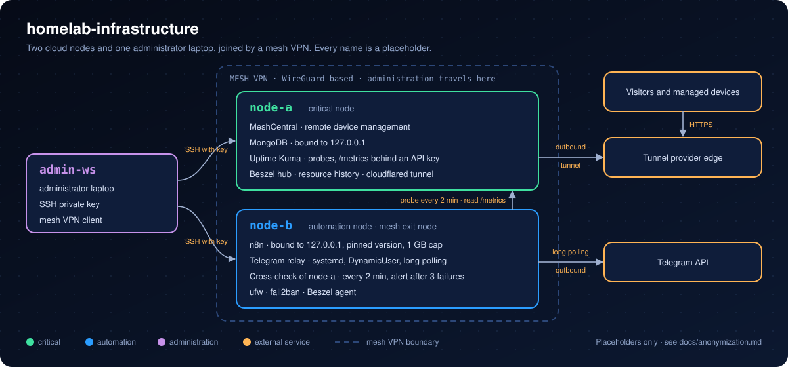
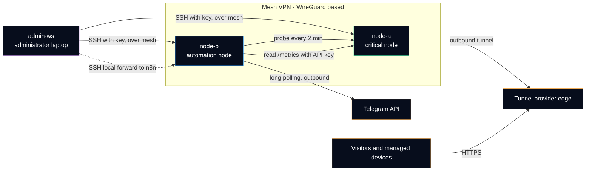

# Architecture overview

Two small cloud servers and one administrator laptop, joined by a mesh VPN. Every name and address on this page is a placeholder (see [anonymization rules](anonymization.md)).

## The three machines

| Machine | Role | Size | Notes |
|---|---|---|---|
| `admin-ws` | Administrator laptop (Windows 11) | — | Starting point of every administrative session. Holds the SSH private key. Sleeps on battery, so it often shows as offline in monitoring: expected, not an outage. |
| `node-a` | **Critical node**: remote device management and monitoring | 4 vCPU, 7.6 GB RAM, 72 GB disk | Provider 1, North America. Hosts the services that other devices depend on. No automation agent runs here. |
| `node-b` | **Automation node**: workflows, alert relay, cross-check of node-a | 2 vCPU, 3.7 GB RAM, 38 GB disk | Provider 2, Europe. Also the mesh VPN exit node. |

Both servers run Ubuntu, keep their clock in **UTC**, and use systemd timers or cron for scheduled tasks (a task that must follow local time says so explicitly, for example `OnCalendar=*-*-* 04:00:00 America/Toronto`).

## Services per node

### node-a (critical)

| Service | Runs as | Reached through | Purpose |
|---|---|---|---|
| MeshCentral | systemd service, dedicated user | HTTPS | Remote management of the owner's devices |
| MongoDB | systemd service | `127.0.0.1` only | Database of MeshCentral |
| Uptime Kuma | Docker container | mesh VPN (n8n reads it by its mesh address) | Availability probes; `/metrics` endpoint protected by an API key |
| Beszel hub and agent | service | web interface | CPU, memory, disk and network history of both servers |
| Outbound tunnel (`cloudflared`) | systemd service | no inbound port | Publishes the public web front-ends through a connection that the server opens itself |

### node-b (automation)

| Service | Runs as | Reached through | Purpose |
|---|---|---|---|
| n8n | Docker container, pinned version, 1 GB memory cap | `127.0.0.1:5678` only, SSH tunnel for the editor | Workflow engine of the read-only status bot |
| Telegram relay | systemd service, `DynamicUser=yes` | no port (long polling, outbound) | Receives bot commands without exposing n8n to the Internet |
| Cross-check of node-a | cron, every 2 minutes | — | Alerts by Telegram after 3 consecutive failures |
| Beszel agent | service | — | Metrics for the hub on node-a |
| ufw and fail2ban | host firewall, log-based banning | — | Filters inbound traffic, bans addresses after repeated failed logins |

> [!NOTE]
> Docker publishes container ports with its own iptables rules, **before** ufw sees the packet. A container published as `-p 5678:5678` would be reachable from the Internet even with ufw set to deny. That is why n8n is published as `-p 127.0.0.1:5678:5678`, and why every new container follows the same rule. Details in the network design page (planned, see the [roadmap](../README.md#roadmap)).

## How traffic flows

Three rules can be read from this diagram:

1. **Administration travels inside the mesh VPN.** SSH, dashboards and the n8n editor are reached through the mesh or through an SSH tunnel, not through the public address. Closing every remaining public administrative port is tracked in the decision record: [ADR 0002](adr/0002-administration-only-over-mesh-vpn.md).
2. **Arrows into node-a come from node-b or from the mesh, never from the automation logic directly.** The bot reads monitoring data; it has no SSH key and no shell on either node. Decision record: [ADR 0003](adr/0003-separate-critical-and-automation-roles.md).
3. **Public services are published by an outbound connection.** The tunnel and the Telegram relay both open the connection from the inside, so no inbound port is needed for them.

## The status bot in one paragraph

A command sent to the Telegram bot is picked up by the relay on node-b (long polling: the relay asks Telegram for new messages, Telegram never connects to the server). The relay drops anything that does not come from the single allowed user ID or is not a known command, then posts a small JSON object to the n8n webhook on `127.0.0.1`. n8n checks the sender and the command a second time, reads the Uptime Kuma metrics of node-a over the mesh VPN, formats one line per probe and answers through the Telegram API. No language model is involved at this stage: the plumbing had to work first. Decision record on how much autonomy the bot may get: [ADR 0004](adr/0004-human-approval-for-irreversible-actions.md).
