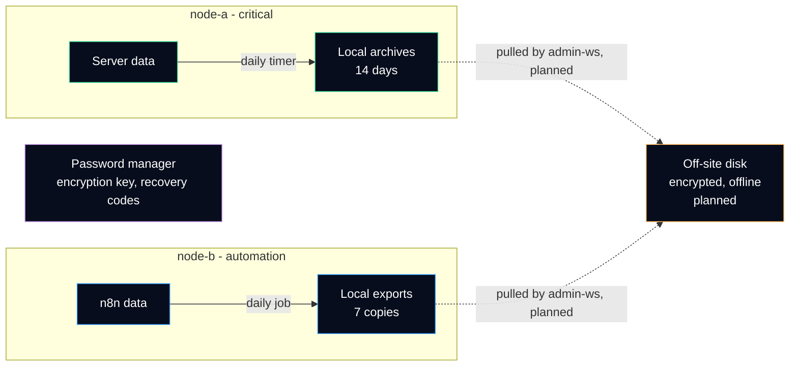

# Backup and recovery

What is backed up, where the copies live, what is deliberately **not** backed up, and how long a recovery is expected to take. Every name and path is a placeholder (see [anonymization rules](../anonymization.md)).

> [!IMPORTANT]
> The honest state first: both nodes make a **daily local backup**, but every copy still lives **on the server it protects**. A lost disk, a deleted server or an attacker with root takes the data and its backups together. The off-site, encrypted copy is planned and waits for hardware. Until then, this page is a plan with one half applied, and it says so.

## Pages in this section

| Page | Question it answers |
|---|---|
| [n8n backup and restore](n8n.md) | How the workflows and credentials are exported, why the encryption key is kept apart, how to restore. |
| [Restore test](restore-test.md) | How to prove a backup can be restored, on a scratch machine, and where the result is recorded. |
| [Rollback plan](../rollback.md) | How to undo a configuration change, written before the change. |
| [Lessons learned](../lessons-learned.md) | What went wrong so far, and what changed because of it. |

Related decision: [ADR 0008](../adr/0008-keep-backups-and-keys-apart.md) (keep backups off the protected node, and the keys apart from the backups).

## Inventory

| Data | Node | Why it matters | Backup today | Schedule | Kept |
|---|---|---|---|---|---|
| Remote management server data (configuration, embedded database, server keys and certificate) | node-a | The managed devices trust the server keys; losing them means reinstalling every agent | Local archive by a systemd timer; its exact content is still to be checked against this row | Daily, 04:30 local time | 14 days |
| n8n workflows and credentials | node-b | The status bot; credentials are encrypted in the database | Local copy by a scheduled job | Daily, 04:00 local time | 7 copies |
| n8n encryption key | node-b | Without it, restored credentials cannot be decrypted | **Must be kept off the server**, apart from the backups ([details](n8n.md#the-encryption-key)) | On change only | — |
| Relay settings, cross-check settings, sshd drop-in, ufw rules | node-b, both | Small text files, slow to rewrite from memory | Rebuilt from this repository (`configs/`, `scripts/`) plus the private values | On change | Git history |
| Uptime Kuma probes and history | node-a | Probe list is useful, history is not critical | No documented backup yet | — | — |
| Beszel history | node-a | Trends only | Not backed up, by choice | — | — |

### Not backed up, on purpose

| Item | Why not | How it comes back |
|---|---|---|
| The operating system | A fresh Ubuntu install is faster and cleaner than restoring a system image, and leaves no hidden change behind | Provider image, then the steps of [network and access](../network/README.md) |
| Container images | Pulled again from the registry; the versions are pinned in the Compose files | `docker compose pull` with the pinned tag |
| Logs and metrics history | Useful for trends, not needed to run the service | Start again empty |
| Secrets in backups (tokens, API keys) | A secret is **rotated**, not restored, when its server is lost or compromised | Create a new token or key at the provider |

## Recovery objectives

Two numbers decide how much a backup system has to do. They are **targets for this small infrastructure**, not measured results.

| Term | Meaning | Target here | What it implies |
|---|---|---|---|
| RPO (recovery point objective) | How much recent data may be lost | 24 hours | One backup per day is enough; a change made today and lost tonight is rewritten by hand |
| RTO (recovery time objective) | How long the service may stay down | node-a: one evening; node-b: a weekend | node-a goes first because devices depend on it; node-b only runs the bot and the cross-check |

An RTO is only true once a restore has been timed. The [restore test](restore-test.md) has a table for that; it is empty until a test is done.

## Where the copies should live

Dashed arrows are not in place yet. Two choices are already fixed:

1. **The off-site copy is pulled, not pushed.** `admin-ws` connects to each node over the mesh VPN and copies the archives. A node never holds credentials that can write to, or delete, the off-site copy, so an attacker on a node cannot erase it.
2. **The keys never travel with the backups.** The n8n encryption key and the account recovery codes live in a password manager, not on the backup disk. A stolen backup disk then gives encrypted data and nothing to open it.

## Rules

1. **A backup that was never restored is a hope, not a backup.** Every backup job gets a [restore test](restore-test.md), and the test is repeated after any change to the job.
2. **Check what was written.** Each archive gets a SHA-256 checksum next to it; [`scripts/verify-backup.sh`](../../scripts/verify-backup.sh) checks the checksum, reads the archive and extracts it into a scratch folder.
3. **Keep a count, not a date.** Rotation keeps the newest N archives. If the job stops, the old archives stay; a date-based cleanup would delete the last good copies while nothing new arrives.
4. **A backup is as sensitive as the server.** The remote management archive contains the server private keys. Backup folders are owned by root, mode `700`, and the off-site disk is encrypted.
5. **After a compromise, rebuild instead of restoring.** A backup taken after the intrusion may carry the intruder's changes. See [lessons learned](../lessons-learned.md#remote-management-server-compromise).

## Tools in this repository

| Script | What it does |
|---|---|
| [`scripts/backup-rotate.sh`](../../scripts/backup-rotate.sh) | Writes a dated `.tar.gz` of one folder with its `.sha256`, then keeps only the newest N archives. `--dry-run` prints the plan. |
| [`scripts/verify-backup.sh`](../../scripts/verify-backup.sh) | Checks the checksum, lists the archive, refuses unsafe paths, extracts into a scratch folder and counts the files. |
| [`configs/backup/`](../../configs/backup/) | Example systemd service and timer for a daily backup at 04:00 local time. |

Both scripts are generic rewrites for this repository, tested offline in CI ([`tests/run-tests.sh`](../../tests/run-tests.sh)). The jobs running on the nodes predate them; replacing them is a follow-up.

## References

- CISA, [#StopRansomware Guide](https://www.cisa.gov/stopransomware/ransomware-guide): "Maintain offline, encrypted backups of critical data" and "regularly test the availability and integrity of backups".
- NIST, [SP 800-34 Rev. 1, Contingency Planning Guide for Federal Information Systems](https://csrc.nist.gov/pubs/sp/800/34/r1/upd1/final) (recovery point and recovery time objectives).
