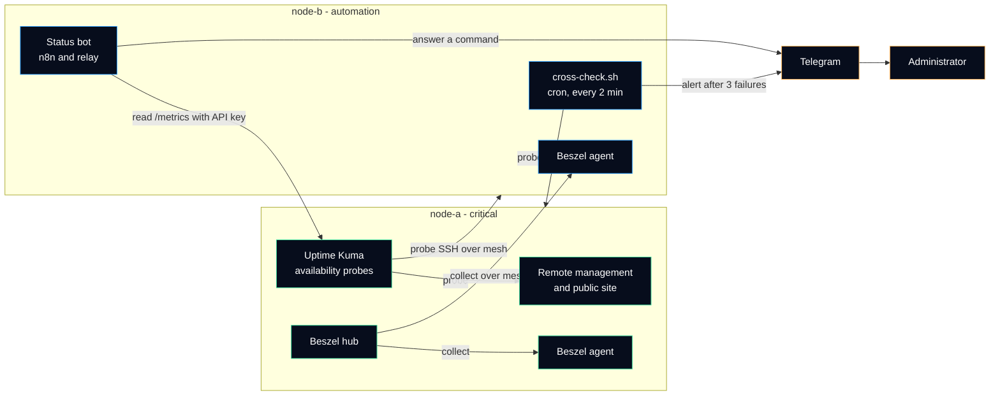

# Monitoring

How the infrastructure knows that something is wrong, and who is told. Every name and address is a placeholder (see [anonymization rules](../anonymization.md)).

> [!NOTE]
> The short version: **three layers, and no machine is trusted to report its own death.** Uptime Kuma answers "is the service up?", Beszel answers "is the server healthy?", and a small script on node-b answers "is node-a still there at all?".

## Pages in this section

| Page | Question it answers |
|---|---|
| [Availability probes - Uptime Kuma](uptime-kuma.md) | Which services are probed, how the metrics endpoint is protected, how the status bot reads it. |
| [Resource history - Beszel](beszel.md) | Where CPU, memory, disk and network history comes from, and how the hub and its agents trust each other. |
| [Cross-check of node-a](cross-check.md) | How node-b watches node-a, when it alerts, how to install it and how to test the alert. |

Related decision: [ADR 0006](../adr/0006-watch-each-node-from-another-node.md) (watch each node from another node).

## Three layers

| Layer | Tool | Runs on | Question | Answer shape |
|---|---|---|---|---|
| Availability | Uptime Kuma | node-a, Docker container | Does each service answer, from the network's point of view? | Up / down / pending / maintenance per probe, response time |
| Resources | Beszel hub, Beszel agent | hub on node-a, agent on both nodes | Is the server running out of CPU, memory, disk or bandwidth? | Time series per server |
| Existence | `cross-check.sh` | node-b, cron every 2 minutes | Is node-a reachable at all? | Telegram alert after 3 consecutive failures, recovery message |

A fourth piece reads the first layer on demand: the **status bot** on node-b answers a Telegram command with one line per Uptime Kuma probe ([architecture](../architecture.md#the-status-bot-in-one-paragraph)). It pulls, it does not alert.

## Who watches whom

Read the arrows by failure:

| What fails | Seen by | How the administrator learns it |
|---|---|---|
| One service on node-a (remote management, public site) | Uptime Kuma on node-a | Status bot command; Kuma notification if one is configured (see *Open points*) |
| node-a as a whole (crash, network, provider outage) | `cross-check.sh` on node-b | Telegram alert, then a recovery message |
| node-b as a whole | Uptime Kuma on node-a (SSH probe of node-b over the mesh) | Kuma dashboard; the status bot is down too, because it runs on node-b |
| Disk filling up, memory pressure | Beszel | Beszel dashboard |
| The mesh VPN between the nodes | Both directions fail at the same time | Cross-check alert, sent by node-b over its public Internet access, which does not depend on the mesh |

Uptime Kuma also has a probe for `admin-ws`. The laptop sleeps on battery, so it is often "down": that probe is expected to be red and is not an incident.

## Rules that follow from the design

1. **A probe must run on a different machine than what it checks** when the question is "is this machine alive?". A server that has crashed sends nothing. Inside one node, Uptime Kuma is fine for "is this service answering?", not for "is this node alive?".
2. **Alert on a streak, not on one failure.** One lost probe is often a network hiccup. Three failures two minutes apart mean about six minutes of real outage before the first alert. That delay is the price of not being woken up by noise.
3. **Say when it is fixed.** A recovery message closes the incident; without it, the administrator must log in to find out whether the alert is still true.
4. **Alert once per incident.** The fourth, fifth and hundredth failure send nothing new. An alert that repeats every two minutes gets muted, and a muted channel misses the next real incident.
5. **Monitoring data is read-only for the automation.** The status bot reads `/metrics` with an API key; it cannot change a probe or a server ([ADR 0003](../adr/0003-separate-critical-and-automation-roles.md)).

## Open points

| Point | Why it matters | State |
|---|---|---|
| Notification channel in Uptime Kuma for node-b and the services of node-a | Today only node-a as a whole raises an alert by itself (cross-check). The other failures are seen when someone looks. | To confirm and document |
| The SSH probe of node-b must target its mesh name | SSH is closed on the public address since 2026-11-11: a probe of the public address now always fails. | Changed in the Uptime Kuma interface; to confirm |
| Beszel alerts (disk, memory) | Beszel can notify on thresholds; whether any threshold is set is not recorded yet. | To confirm and document |
| Bind address of the monitoring containers on node-a | Must be reachable over the mesh, not from the Internet ([ADR 0005](../adr/0005-publish-container-ports-on-loopback.md)). | On the [verification checklist](../network/access-verification.md) |

## References

- Uptime Kuma, [project repository and wiki](https://github.com/louislam/uptime-kuma/wiki).
- Beszel, [documentation](https://beszel.dev/guide/what-is-beszel).
- Google SRE book, [Monitoring Distributed Systems](https://sre.google/sre-book/monitoring-distributed-systems/) (symptoms versus causes, alerts that a human must act on).
