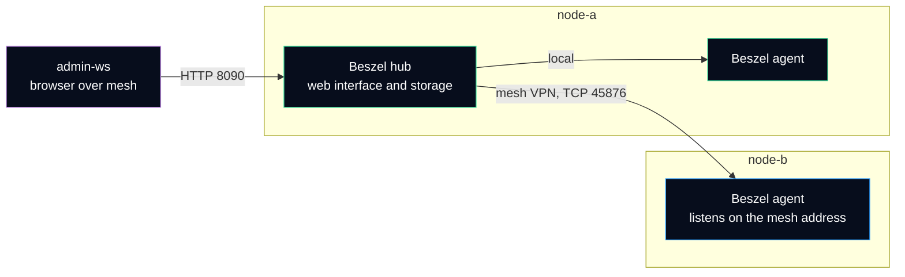

# Resource history - Beszel

Uptime Kuma says whether a service answers. It does not say that the disk will be full on Thursday. **Beszel** keeps the history of CPU, memory, disk, network and container usage of both nodes, so a slow problem is seen before it becomes an outage.

| | |
|---|---|
| Hub | node-a, web interface on port 8090, reached over the mesh VPN |
| Agents | node-a and node-b |
| Version | hub and agents 0.20.0, kept at the same version |
| Data kept | time series per node and per container |

## How the hub and the agents work



- The **hub** is a small web application with its own database. It stores the history and draws the charts.
- The **agent** is a single binary on each node. It reads the counters of the kernel (and of Docker, when present) and hands them to the hub. It stores nothing.
- **Trust in one direction.** When the hub adds a system, it shows its public key. The agent is started with that key (`KEY`) and answers only a hub that proves it holds the matching private key. A stranger who reaches the agent port gets nothing. Recent versions can also make the agent connect to the hub with a token (`TOKEN` and `HUB_URL`); which of the two modes each node uses is recorded in the interface (*Systems*).

Why the agent of node-b is reached **over the mesh**: its port does not need to be public, and the mesh already authenticates both machines. The agent can be told to listen on the mesh address only (`LISTEN=192.0.2.20:45876`); the [port audit script](../../scripts/audit-listening-ports.sh) then reports it as `SPECIFIC` instead of open on all interfaces.

## What to look at, and when

| Chart | What a bad trend looks like | First action |
|---|---|---|
| Disk usage | Grows every day without coming back down | Find the folder with `sudo du -xh --max-depth=1 / \| sort -h`; usually logs, Docker images or backups |
| Memory | Stays near the limit, swap grows | `systemctl status` of the biggest service; n8n has a 1 GB memory cap on purpose |
| CPU | Long plateaus at 100 % | `top` or `htop`; a stuck process or a scan against a public port |
| Network | Unusual outbound traffic | `ss -tunp` to find the process; treat as a possible incident |
| Containers | One container grows without limit | `docker stats --no-stream` |

The value of history is the **comparison**: "80 % disk" means little; "80 % today, 60 % last week" means a full disk in about two weeks.

## Alerts

Beszel can send a notification when a node stops reporting or when a metric stays above a threshold for a chosen number of minutes (CPU, memory, disk, bandwidth, temperature, load). Notifications go by e-mail or through a webhook service such as Telegram.

Whether thresholds are set on these nodes is **not recorded yet** (see [open points](README.md#open-points)). When they are, the proposed starting values are:

| Alert | Threshold | Duration | Why |
|---|---|---|---|
| Status | node stops reporting | — | Second path for "node-b is down", independent of the cross-check |
| Disk | 80 % | 10 min | Leaves time to clean up before services fail to write |
| Memory | 90 % | 10 min | Short peaks are normal; a long plateau is not |

A threshold that fires every day gets ignored. Start high, then lower it only when a real incident would have been caught earlier.

## Updating

The hub and the agents talk a common protocol: update the hub first, then each agent, to the same version. Read the release notes before a major change.

```bash
# On each node, for an agent installed as a systemd service
systemctl status beszel-agent --no-pager
journalctl -u beszel-agent --since "10 min ago" --no-pager
```

After the update, each system must show as *up* in the hub within a minute.

## References

- Beszel documentation, [What is Beszel](https://beszel.dev/guide/what-is-beszel), [Getting started](https://beszel.dev/guide/getting-started), [Agent installation](https://beszel.dev/guide/agent-installation), [Environment variables](https://beszel.dev/guide/environment-variables) and [Notifications](https://beszel.dev/guide/notifications/).
- Project repository: [henrygd/beszel](https://github.com/henrygd/beszel).
