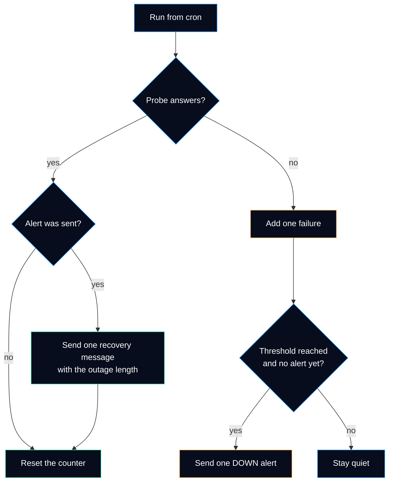

# Cross-check of node-a

node-b checks every 2 minutes that node-a still answers, and tells the administrator on Telegram when it does not. This is the only part of the monitoring that still works when node-a is completely gone. Decision record: [ADR 0006](../adr/0006-watch-each-node-from-another-node.md).

| | |
|---|---|
| Script | [`scripts/cross-check.sh`](../../scripts/cross-check.sh) (generic rewrite of the script running on node-b, with tests) |
| Schedule | [`configs/monitoring/cross-check.cron`](../../configs/monitoring/cross-check.cron), every 2 minutes |
| Configuration | [`configs/monitoring/cross-check.conf.example`](../../configs/monitoring/cross-check.conf.example) |
| Runs as | `cross-check`, a system user without a login shell |
| Needs | `bash`, `curl`, `timeout`, `flock` (all in a default Ubuntu server) |

## How it decides

Each probe has its own counter of consecutive failures, stored in `/var/lib/cross-check/<probe>.state` as three numbers: failures, alert sent (0 or 1), start of the outage.



| Situation | What the administrator receives |
|---|---|
| One failed check, then OK | Nothing. A network hiccup is not an incident. |
| 3 failed checks in a row | One message: `DOWN node-a-ssh (tcp node-a:22): 3 consecutive failed checks, last at <time> UTC` |
| Still down an hour later | Nothing more. One outage, one alert. |
| Back up | One message: `RECOVERED node-a-ssh (tcp node-a:22) at <time> UTC, down for about 14 min` |
| Telegram unreachable when the alert is due | Nothing yet; the script exits with code 3 and tries again on the next run. |

### The probe types

| Type | Target | Passes when | Why this type |
|---|---|---|---|
| `tcp` | `node-a:22` | A TCP connection opens | Proves the node, its network and the mesh link are up, without logging in. No SSH key is needed on node-b. |
| `http` | `http://node-a:3001/metrics` | Any HTTP answer below 500 | `401 Unauthorized` without the API key still proves that Uptime Kuma runs. The cross-check never holds the key. |
| `http` | `https://remote.example.com` | Same | The public front-end, seen through its public name and certificate path. |
| `ping` | `node-a` | One echo reply | Available, but weaker: a node can answer ping while every service is down. |

Targets use **mesh names**, so a broken mesh link also raises the alert: administration would be cut, and that is worth knowing.

### Design choices in the script

- **The configuration is read as data, never executed.** A `source`d file can run any command with the rights of the service. Here every line must be `KEY=VALUE` with a known key, or the script stops with exit code 2.
- **The bot token is not on the command line.** It is read from its own file and handed to `curl` on stdin (`-K -`). An argument is visible to every local user in `ps`; stdin is not.
- **Every probe is validated before the first one runs.** A typo in the fifth probe does not leave the first four half updated.
- **The state is written to a temporary file, then renamed.** A crash or a full disk never leaves half a line that would reset the counter.
- **A lock prevents two runs at once** (`flock`). A slow run that overlaps the next would count the same failure twice.

## Install on node-b

Run as an administrator on node-b, from a clone of this repository. Every value in angle brackets is to be replaced.

```bash
# 1. System user without a login shell, and its state directory
sudo useradd --system --no-create-home --shell /usr/sbin/nologin cross-check
sudo install -d -o cross-check -g cross-check -m 750 /var/lib/cross-check

# 2. The script, owned by root so the service account cannot change it
sudo install -o root -g root -m 755 scripts/cross-check.sh /usr/local/sbin/cross-check.sh

# 3. Configuration (readable by the service, not writable by it)
sudo install -d -o root -g cross-check -m 750 /etc/cross-check
sudo install -o root -g cross-check -m 640 configs/monitoring/cross-check.conf.example /etc/cross-check/cross-check.conf
sudoedit /etc/cross-check/cross-check.conf      # set TELEGRAM_CHAT_ID and the probes

# 4. The bot token in its own file; typed into the editor, never on a command line
sudo install -o cross-check -g cross-check -m 400 /dev/null /etc/cross-check/telegram.token
sudoedit /etc/cross-check/telegram.token        # paste <TELEGRAM_BOT_TOKEN>, save

# 5. A dry run first: probes run, nothing is sent, the real state is not touched
sudo -u cross-check /usr/local/sbin/cross-check.sh \
  --config /etc/cross-check/cross-check.conf --state-dir /tmp/cross-check-test --dry-run
echo "exit code: $?"                            # 0 = every probe passed

# 6. Schedule it
sudo install -o root -g root -m 644 configs/monitoring/cross-check.cron /etc/cron.d/cross-check
```

Expected result of step 5: one `OK` line per probe and exit code `0`. A `FAIL` line here means a wrong target or a mesh problem; fix it before step 6, or the first alert arrives six minutes later.

> [!NOTE]
> Why `sudoedit` for the token: `echo <token> > file` would leave the token in the shell history, and `sudo tee` with the token as an argument would show it in `ps`. The editor writes it straight into the file.

## Test the alert path

A monitoring system that was never seen alerting is a hope, not a control. Test the whole chain, Telegram included, without touching node-a: a separate configuration probes a port that is always closed.

```bash
# Temporary configuration: one probe that always fails, alert at the first failure
printf '%s\n' 'PROBE=alert-test|tcp|127.0.0.1:1' 'THRESHOLD=1' \
  'TELEGRAM_CHAT_ID=<TELEGRAM_USER_ID>' 'TELEGRAM_TOKEN_FILE=/etc/cross-check/telegram.token' \
  | sudo tee /etc/cross-check/alert-test.conf >/dev/null
sudo chgrp cross-check /etc/cross-check/alert-test.conf

# Run once: a DOWN message must arrive on Telegram
sudo -u cross-check /usr/local/sbin/cross-check.sh \
  --config /etc/cross-check/alert-test.conf --state-dir /tmp/cross-check-alert-test

# Recovery: point the same probe name at a port that answers (SSH), run again
sudo sed -i 's|127.0.0.1:1|127.0.0.1:22|' /etc/cross-check/alert-test.conf
sudo -u cross-check /usr/local/sbin/cross-check.sh \
  --config /etc/cross-check/alert-test.conf --state-dir /tmp/cross-check-alert-test

# Clean up
sudo rm -rf /etc/cross-check/alert-test.conf /tmp/cross-check-alert-test
```

| Step | Expected | If not |
|---|---|---|
| First run | `FAIL  alert-test (1/1)`, exit code 1, a `DOWN alert-test` message on Telegram | Exit code 3: token, chat ID or outbound HTTPS from node-b |
| Second run | `OK    alert-test`, exit code 0, a `RECOVERED alert-test` message | No message: the state directory was not the same in both runs |

Record the date of the last successful test; repeat it after any change of token, chat or script.

## Daily use

```bash
# What the last runs saw
journalctl -t cross-check --since "1 hour ago" --no-pager

# The counters right now
sudo -u cross-check sh -c 'for f in /var/lib/cross-check/*.state; do printf "%s: %s\n" "$f" "$(cat "$f")"; done'
```

Planned maintenance on node-a: expect a DOWN alert after six minutes and a RECOVERED message at the end. To stay silent, comment out the line in `/etc/cron.d/cross-check` during the work, and **put it back** afterwards: a forgotten comment is a monitoring outage that nobody sees.

## Exit codes

| Code | Meaning | Seen where |
|---|---|---|
| 0 | Every probe passed | — |
| 1 | At least one probe failed (alert sent or not yet due) | Journal |
| 2 | Usage or configuration error: nothing was probed | Journal; fix the configuration |
| 3 | An alert or a recovery message could not be sent; retried on the next run | Journal |

## Roll back

```bash
sudo rm /etc/cron.d/cross-check                 # stops the checks at once
sudo rm -rf /etc/cross-check /var/lib/cross-check /usr/local/sbin/cross-check.sh
sudo userdel cross-check
```

Removing the cron file is enough to stop it; the other lines remove every trace. If the previous script is being replaced, keep its cron line commented out, not deleted, until the new one has sent a real alert and a real recovery.

## References

- Telegram Bot API, [sendMessage](https://core.telegram.org/bots/api#sendmessage).
- curl manual, [`-K, --config`](https://curl.se/docs/manpage.html#-K) and [`--data-urlencode`](https://curl.se/docs/manpage.html#--data-urlencode).
- Ubuntu manuals, [crontab(5)](https://manpages.ubuntu.com/manpages/noble/man5/crontab.5.html), [flock(1)](https://manpages.ubuntu.com/manpages/noble/man1/flock.1.html), [timeout(1)](https://manpages.ubuntu.com/manpages/noble/man1/timeout.1.html).
- Bash manual, [Redirections](https://www.gnu.org/software/bash/manual/html_node/Redirections.html) (`/dev/tcp/host/port`).
