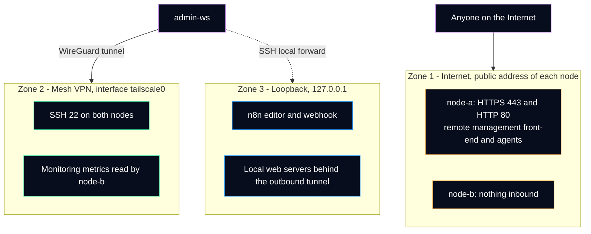

# Network design and access

How the three machines are connected, which address each service listens on, and how the administrator gets in. Every name and address is a placeholder (see [anonymization rules](../anonymization.md)).

> [!NOTE]
> The short version: **three zones, one rule per zone.** The Internet sees only the services that are meant to be public. The mesh VPN carries all administration. Everything else listens on `127.0.0.1` and is reached through an SSH tunnel.

## Pages in this section

| Page | Question it answers |
|---|---|
| [Mesh VPN](mesh-vpn.md) | How are the nodes joined, how is a device added, what is the exit node for? |
| [SSH access](ssh-access.md) | How is SSH limited to keys, and how is it hardened without locking the administrator out? |
| [Host firewall](host-firewall.md) | Which inbound traffic does ufw accept, and on which interface? |
| [Docker on loopback](docker-loopback.md) | Why a published container port can ignore the firewall, and how it is prevented. |
| [Verify access from outside](access-verification.md) | How to prove the rules hold, from the node and from a machine outside the mesh. |

Related decisions: [ADR 0002](../adr/0002-administration-only-over-mesh-vpn.md) (administration only over the mesh) and [ADR 0005](../adr/0005-publish-container-ports-on-loopback.md) (container ports on loopback).

## Three zones

| Zone | Who can reach it | Rule | Enforced by |
|---|---|---|---|
| Internet (public IPv4 of each node) | Anyone | Only services meant for the public. Administration never. | Host firewall (`ufw`), services bound to loopback, outbound tunnels |
| Mesh VPN (`tailscale0`) | Devices enrolled in the mesh account | Administration: SSH, dashboards, metrics between nodes | Mesh enrollment and keys, `ufw allow in on tailscale0` |
| Loopback (`127.0.0.1`) | Processes on the same node, or an SSH local forward | Databases, workflow editor, local web servers | Bind address of the service, Docker `-p 127.0.0.1:...` |

## Address plan (placeholders)

| Machine | Public address | Mesh address | Mesh name |
|---|---|---|---|
| `node-a` | `198.51.100.10` | `192.0.2.10` | `node-a` |
| `node-b` | `203.0.113.20` | `192.0.2.20` | `node-b` |
| `admin-ws` | changes with the network | `192.0.2.30` | `admin-ws` |

The real mesh addresses come from the `100.64/10` shared range ([RFC 6598](https://www.rfc-editor.org/rfc/rfc6598)) and stay the same for the life of a device. Mesh names resolve only for devices inside the mesh (MagicDNS), so scripts and SSH use the names, never the addresses.

## Port matrix

What is allowed to listen, and where. "Public" means reachable from the Internet.

| Node | Service | Bind address | Public | Through the mesh | Reached by |
|---|---|---|---|---|---|
| node-a | Remote management web front-end and agents | all interfaces, TCP 443 | **Yes** | Yes | Managed devices, administrator |
| node-a | HTTP, redirect to HTTPS and certificate validation | all interfaces, TCP 80 | **Yes** | Yes | Certificate authority, browsers |
| node-a | SSH | all interfaces, filtered by ufw | No | Yes | admin-ws |
| node-a | Availability monitoring, metrics endpoint with API key | Docker published port | No (target) | Yes | n8n on node-b |
| node-a | Local web server of the public site | `127.0.0.1` | No | No | Outbound tunnel on the same node |
| node-b | SSH | all interfaces, filtered by ufw | No | Yes | admin-ws |
| node-b | n8n editor and webhook | `127.0.0.1:5678` | No | No | Telegram relay on the same node, SSH local forward |
| node-b | Mesh VPN exit node | — | No | Yes | admin-ws on untrusted networks |
| both | Mesh VPN client (WireGuard) | UDP, outbound first | Not needed | — | NAT traversal |

"No (target)" means the rule is decided but has not yet been confirmed from outside: it is on the [verification checklist](access-verification.md).

## Why filter SSH with the firewall and not with `ListenAddress`

`sshd` can be told to listen only on the mesh address (`ListenAddress 192.0.2.10`). It was not done that way on purpose:

- The mesh interface appears only after the mesh client has started. If `sshd` starts first, it cannot bind the address and SSH is down on **every** interface. That is a lockout at reboot, exactly when the administrator needs access.
- On Ubuntu 24.04, SSH is socket-activated: the listening address is set in `ssh.socket`, not only in `sshd_config`, which adds a second place to keep in sync.
- `ufw allow in on tailscale0 to any port 22` gives the same result (SSH is unreachable from the public address) and does not depend on start-up order.

## References

- Tailscale, [What is Tailscale?](https://tailscale.com/kb/1151/what-is-tailscale) and [MagicDNS](https://tailscale.com/kb/1081/magicdns).
- OpenBSD manual, [sshd_config(5)](https://man.openbsd.org/sshd_config) (`ListenAddress`).
- Ubuntu Server documentation, [OpenSSH server](https://documentation.ubuntu.com/server/how-to/security/openssh-server/).
- [RFC 5737](https://www.rfc-editor.org/rfc/rfc5737) (documentation addresses), [RFC 6598](https://www.rfc-editor.org/rfc/rfc6598) (shared address space).
