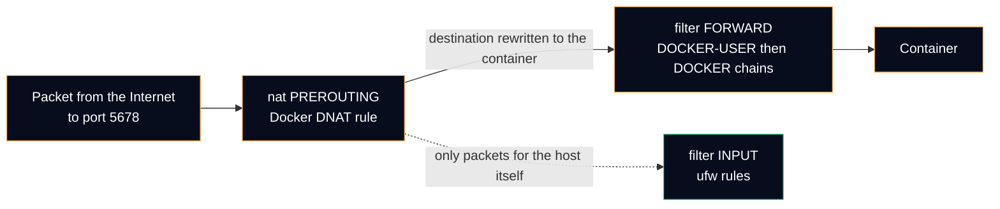

# Docker on loopback

The most common way to expose a service by accident on a server with a firewall: publish a Docker container port. This page shows why it happens and the rule that prevents it. The decision is recorded in [ADR 0005](../adr/0005-publish-container-ports-on-loopback.md).

## Why ufw does not protect a published port



ufw filters the packets **addressed to the host** (the `INPUT` chain). A published container port is translated by Docker in `PREROUTING`: the packet is now addressed to the container, travels through `FORWARD`, and never meets the ufw input rules. `ufw status` shows "deny" and the port answers anyway.

## The rule

| Instead of | Write | Result |
|---|---|---|
| `-p 5678:5678` | `-p 127.0.0.1:5678:5678` | Docker listens on loopback only. Nothing outside the node can connect, whatever the firewall rules say. |
| `ports: ["5678:5678"]` (Compose) | `ports: ["127.0.0.1:5678:5678"]` | Same, in a Compose file. |

The service is then reached:

| From | How |
|---|---|
| The same node (Telegram relay to the n8n webhook) | `http://127.0.0.1:5678/...` directly |
| admin-ws (n8n editor) | SSH local forward over the mesh: `ssh -N -L 5678:127.0.0.1:5678 <ADMIN_USER>@node-b`, then `http://127.0.0.1:5678` |
| The Internet | Not at all. A public service would go through an outbound tunnel or a reverse proxy |

Full Compose example with the other settings used for n8n (pinned version, memory cap, log rotation, execution pruning): [`configs/docker/n8n.compose.example.yml`](../../configs/docker/n8n.compose.example.yml).

## When loopback is not possible

A container that another node must reach (the monitoring metrics read by node-b) cannot listen on loopback only. Two options, in order of preference:

1. **Bind to the mesh address**: `-p 192.0.2.10:3001:3001`. Only the mesh can reach it. Limit: the mesh interface must be up before the container starts, or Docker fails to bind the address.
2. **Publish normally and filter in `DOCKER-USER`**, the chain Docker reserves for administrator rules and evaluates before its own:

   ```bash
   # Drop new connections to published ports that arrive on the public interface
   sudo iptables -I DOCKER-USER -i eth0 -m conntrack --ctstate NEW -j DROP
   ```

   `eth0` stands for the public interface. These rules are not saved by ufw and need their own persistence; that is why it is the second choice.

Which of the two applies to the monitoring container of node-a is an open follow-up of ADR 0005.

## Default for the future

`/etc/docker/daemon.json` can make loopback the default bind address, so a forgotten `127.0.0.1:` in a future `docker run` does not open a port to the world:

```json
{
  "ip": "127.0.0.1"
}
```

It applies after `sudo systemctl restart docker`, which restarts the containers. Proposed, not applied yet.

## Check

```bash
# Every published port, with its bind address
docker ps --format '{{.Names}}\t{{.Ports}}'
# Good:  n8n    127.0.0.1:5678->5678/tcp
# Bad:   n8n    0.0.0.0:5678->5678/tcp, [::]:5678->5678/tcp
```

The [audit script](../../scripts/audit-listening-ports.sh) runs the same check on every listening socket of the node ([verification checklist](access-verification.md)).

## References

- Docker Docs, [Packet filtering and firewalls](https://docs.docker.com/engine/network/packet-filtering-firewalls/), [Port publishing and mapping](https://docs.docker.com/engine/network/port-publishing/).
- Docker Docs, [dockerd reference: daemon configuration file](https://docs.docker.com/reference/cli/dockerd/#daemon-configuration-file).
- n8n Docs, [Docker installation](https://docs.n8n.io/hosting/installation/docker/) and [Execution data](https://docs.n8n.io/hosting/scaling/execution-data/).
