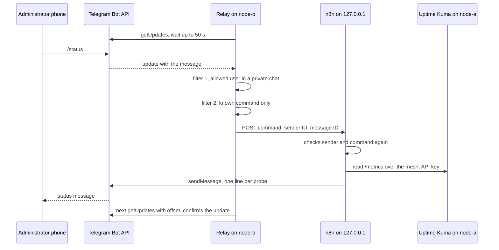

# Telegram relay

The status bot answers Telegram commands, but its workflow engine (n8n) listens on `127.0.0.1` only. The relay is the small program that bridges the two **without opening any inbound port**: it fetches messages from Telegram itself, keeps only the known commands of one user, and posts them to the local webhook. Decision record: [ADR 0007](../adr/0007-pull-bot-commands-by-long-polling.md).

| | |
|---|---|
| Code | [`relay/telegram_relay.py`](../../relay/telegram_relay.py), Python standard library only |
| Service | [`configs/systemd/telegram-relay.service`](../../configs/systemd/telegram-relay.service), explained [line by line](systemd-unit.md) |
| Settings | [`configs/systemd/telegram-relay.conf.example`](../../configs/systemd/telegram-relay.conf.example), copied to `/etc/telegram-relay/relay.conf` |
| Secret | Bot token in `/etc/telegram-relay/telegram.token` (root, mode 600), given to the service by `LoadCredential=` |
| Installer | [`scripts/install-telegram-relay.sh`](../../scripts/install-telegram-relay.sh), with `--dry-run` |
| Tests | [`tests/test_telegram_relay.py`](../../tests/test_telegram_relay.py) (relay) and [`tests/run-tests.sh`](../../tests/run-tests.sh) (installer), run in CI |
| Runs on | node-b only ([ADR 0003](../adr/0003-separate-critical-and-automation-roles.md)) |

## Why a relay is needed

A Telegram bot receives its messages in one of two ways ([Bot API, getting updates](https://core.telegram.org/bots/api#getting-updates)):

| Way | Who opens the connection | What the server needs |
|---|---|---|
| Webhook | **Telegram** connects to the server | A public HTTPS address, a certificate, an open port |
| Long polling (`getUpdates`) | **The server** connects to Telegram and waits up to 50 s for news | Outbound HTTPS only |

The Telegram trigger of n8n uses the webhook way. Using it would mean publishing n8n on the Internet, against [ADR 0005](../adr/0005-publish-container-ports-on-loopback.md). The relay takes the long polling way and keeps n8n on loopback.

## How a command travels



## The two filters

1. **Who.** The message must come from `RELAY_ALLOWED_USER_ID`, in a **private** chat whose ID is that same user. Anything else (another account, a group the bot was added to, a channel) is dropped **without any answer**: a stranger cannot even learn that the bot is alive.
2. **What.** Only the commands in `RELAY_COMMANDS` are forwarded, and only as a command name. The text of the message never reaches n8n. Anything else from the administrator gets the help text.

n8n then checks the sender and the command a second time. If one filter is broken by a bad change, the other still holds.

What is sent to the webhook is always this small object, never the original message:

```json
{"command": "/status", "from_id": 123456789, "message_id": 42}
```

## Settings

All settings live in `/etc/telegram-relay/relay.conf`, read by systemd (`EnvironmentFile=`). The relay checks them at start and exits with code 2 on the first problem; the unit does not restart it in that case.

| Variable | Required | Default | Checked |
|---|---|---|---|
| `RELAY_ALLOWED_USER_ID` | Yes | — | A positive number (Telegram user IDs are numeric) |
| `RELAY_WEBHOOK_URL` | Yes | — | `http` or `https`, and the host must be loopback (`127.0.0.0/8`, `::1`, `localhost`) |
| `RELAY_COMMANDS` | No | `/status` | Each one: a slash, then up to 32 lowercase letters, digits or underscores |
| `RELAY_POLL_TIMEOUT` | No | `50` | 0 to 50 seconds |
| `RELAY_API_BASE` | No | `https://api.telegram.org` | `https`; plain `http` only on loopback, for the tests |

The token is **not** a setting. systemd copies `/etc/telegram-relay/telegram.token` into a private directory that only the service user can read (`$CREDENTIALS_DIRECTORY`), and the relay reads it there. It is never in the environment, where `systemctl show` or a crash report could expose it, and never in the code. The relay also refuses a token that does not look like `digits:letters`, so a stray space or slash cannot change the API address.

## What is logged

The relay writes to the journal (`journalctl -u telegram-relay`):

| Event | Logged | Never logged |
|---|---|---|
| Start | Offset, list of commands | Token, user ID |
| Rejected message | Sender ID and chat type | The text of the message |
| Forwarded command | Command name and HTTP status of the webhook | — |
| Bot API error | Method name and HTTP code or error type | The request URL, which contains the token |

Python error messages can contain the URL of a failed request. The relay builds its own error messages and drops the original exception (`raise ... from None`), so no traceback can carry the token. A unit test checks it.

## When something fails

| Failure | What the relay does | What the administrator sees |
|---|---|---|
| Internet or Bot API down | Retries after 1, 2, 4 ... up to 60 seconds | No answer to commands until it is back |
| A webhook was registered on the bot | Calls `deleteWebhook` at start, keeps the pending messages | Nothing |
| n8n stopped | Logs `webhook unreachable` | "The workflow engine is unreachable on this node." |
| Workflow inactive or path changed | Logs `webhook refused ... HTTP 404` | "The workflow refused the request (HTTP 404). Is it active?" |
| One update makes the handler crash | Logs the error type, goes on with the next update | No answer to that message |
| Relay restarted | Reads the saved offset | No message is handled twice |
| Wrong setting | Exits with code 2, no restart loop | The bot stays silent; the journal says which setting |

The offset is saved **before** an update is handled. A message that crashes the relay is therefore confirmed anyway and cannot crash it again after the restart. Telegram keeps unconfirmed updates for at most 24 hours ([getUpdates](https://core.telegram.org/bots/api#getupdates)).

## Install on node-b

```bash
# 1. Settings (no secret): copy the example and replace the placeholders
sudo install -d -o root -g root -m 755 /etc/telegram-relay
sudo install -o root -g root -m 644 configs/systemd/telegram-relay.conf.example /etc/telegram-relay/relay.conf
sudoedit /etc/telegram-relay/relay.conf          # <TELEGRAM_USER_ID> and <WEBHOOK_PATH>

# 2. Token: create the file empty with the right mode first, then paste the token
sudo install -o root -g root -m 600 /dev/null /etc/telegram-relay/telegram.token
sudoedit /etc/telegram-relay/telegram.token      # paste <TELEGRAM_BOT_TOKEN>, save

# 3. Check everything, change nothing
bash scripts/install-telegram-relay.sh --dry-run --expect-host node-b

# 4. Install and start
sudo bash scripts/install-telegram-relay.sh --expect-host node-b
```

Why `sudoedit` and not `echo <token> | sudo tee ...`: a command line stays in the shell history and is visible in `ps` while it runs. The editor writes the token into the file and nowhere else. Creating the file with mode 600 **before** writing into it means the token is never, even for a second, in a file that others can read.

## Verify

```bash
systemctl is-active telegram-relay.service                 # active
journalctl -u telegram-relay -n 20 --no-pager              # relay started, offset=..., commands=/status
systemd-analyze security telegram-relay.service            # exposure score, lower is better
ss -tlnp | grep -i python || echo "no listening socket"    # the relay listens on nothing
```

Then, from the phone:

| Test | Expected |
|---|---|
| `/status` from the administrator account | One line per Uptime Kuma probe |
| `hello` from the administrator account | The help text |
| `/status` from **another** Telegram account | **No answer at all**, and `rejected: sender=... chat='private'` in the journal |
| `/status` with n8n stopped (`docker stop <N8N_CONTAINER>`, then start it again) | "The workflow engine is unreachable on this node." |

## Rollback

```bash
sudo systemctl disable --now telegram-relay.service
sudo rm -f /etc/systemd/system/telegram-relay.service
sudo rm -rf /usr/local/lib/telegram-relay /var/lib/private/telegram-relay
sudo systemctl daemon-reload
# Optional, to stop using the bot for good: revoke the token with BotFather (/revoke)
sudo rm -f /etc/telegram-relay/telegram.token
```

Nothing else depends on the relay: n8n, Uptime Kuma and the cross-check keep working. Only the `/status` command stops answering.

## This version and the running one

The relay on node-b predates this repository. This version is its generic rewrite, kept as close as possible:

| Point | Running relay | This repository |
|---|---|---|
| User ID, webhook, commands | Constants in the code | Environment variables, validated at start |
| Command name | A command in the owner's language | `/status` by default, any list through `RELAY_COMMANDS` |
| Token | `LoadCredential=` from a root-only file | Same, path `/etc/telegram-relay/telegram.token` |
| Wrong node guard | Real hostname written in the installer | `--expect-host` option, no hostname in the script |
| Configuration error | Restart every 10 s | Exit code 2, no restart (`RestartPreventExitStatus=2`) |
| Tests | Manual test at the start of service | Unit tests in CI |

Open points:

- Replace the running relay with this version (the rollback above removes the old one first; the unit and folder names differ, so check both).
- The webhook on `127.0.0.1` accepts a request from any local process of node-b. A shared secret header between the relay and n8n (n8n *Header Auth* on the webhook) would close that gap; it is **not** in place.

## References

- Telegram Bot API: [getUpdates](https://core.telegram.org/bots/api#getupdates), [deleteWebhook](https://core.telegram.org/bots/api#deletewebhook), [sendMessage](https://core.telegram.org/bots/api#sendmessage).
- systemd: [systemd.exec, credentials and sandboxing](https://www.freedesktop.org/software/systemd/man/latest/systemd.exec.html), [systemd.service, Restart= and RestartPreventExitStatus=](https://www.freedesktop.org/software/systemd/man/latest/systemd.service.html).
- Python: [urllib.request](https://docs.python.org/3/library/urllib.request.html), [unittest](https://docs.python.org/3/library/unittest.html).
